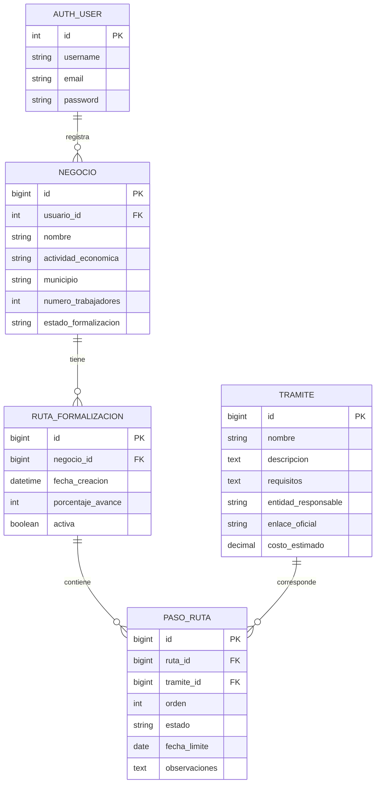

# FormalizaPaso

Aplicación web desarrollada con Django para orientar a pequeños negocios y emprendimientos durante su proceso de formalización.

FormalizaApp busca presentar de manera sencilla los trámites que pueden aplicar a un negocio, sus requisitos, costos aproximados y el orden en el que deben realizarse. También permite organizar una ruta de formalización y consultar el avance de cada paso.

## Problemática

Muchos pequeños negocios no avanzan en su proceso de formalización porque desconocen los trámites, no saben por dónde comenzar o encuentran información dispersa y difícil de entender.

FormalizaApp propone centralizar esta información y convertirla en una ruta sencilla de pasos que el emprendedor pueda consultar y actualizar.

## Objetivo

Desarrollar una aplicación web que permita registrar un negocio, consultar los trámites relacionados con su formalización y organizar dichos trámites dentro de una ruta personalizada.

El proyecto se relaciona con el **Objetivo de Desarrollo Sostenible 8: Trabajo decente y crecimiento económico**, al facilitar el acceso a información que puede apoyar la transición de pequeños negocios hacia la formalidad.

## Funciones principales

- Registro de usuarios mediante el sistema de autenticación de Django.
- Registro de la información básica de un negocio.
- Clasificación general de la actividad económica.
- Consulta de trámites, requisitos, entidades responsables y costos aproximados.
- Creación de una ruta de formalización para cada negocio.
- Organización de los trámites en pasos.
- Seguimiento del estado de cada paso: pendiente, en proceso o completado.

## Tecnologías

- Python
- Django
- SQLite
- HTML y CSS
- Git y GitHub
- dbdiagram.io

## Aplicación de Django

El proyecto contiene una aplicación principal llamada:

```text
formalizacion
```

Esta aplicación administra los negocios, los trámites y las rutas de formalización.

## Modelos de datos

### Negocio

Almacena la información básica del emprendimiento:

- Usuario propietario.
- Nombre del negocio.
- Actividad económica.
- Municipio.
- Número de trabajadores.
- Estado de formalización.

### Tramite

Contiene la información necesaria para orientar al emprendedor:

- Nombre del trámite.
- Descripción.
- Requisitos.
- Entidad responsable.
- Enlace oficial.
- Costo estimado.

### RutaFormalizacion

Representa la ruta creada para un negocio:

- Negocio asociado.
- Fecha de creación.
- Porcentaje de avance.
- Estado de la ruta.

### PasoRuta

Relaciona una ruta con los trámites que debe realizar el negocio:

- Ruta de formalización.
- Trámite.
- Orden del paso.
- Estado.
- Fecha límite.
- Observaciones.

## Diagrama de base de datos

El diagrama interactivo puede consultarse en el siguiente enlace:

### [Ver diagrama en dbdiagram.io](https://dbdiagram.io/e/6ae01216ed134e407e145eb7/6ae01896aac33014102b7953)



## Relaciones principales

- Un usuario puede registrar varios negocios.
- Un negocio puede tener una o varias rutas de formalización.
- Una ruta de formalización contiene varios pasos.
- Cada paso corresponde a un trámite.
- Un mismo trámite puede aparecer en las rutas de distintos negocios.

## Estructura del proyecto

```text
FormalizaApp/
├── config/
│   ├── settings.py
│   ├── urls.py
│   ├── asgi.py
│   └── wsgi.py
├── formalizacion/
│   ├── migrations/
│   ├── admin.py
│   ├── apps.py
│   ├── models.py
│   ├── tests.py
│   └── views.py
├── manage.py
├── requirements.txt
└── README.md
```

## Instalación

### 1. Clonar el repositorio

```bash
git clone https://github.com/softhamck/FormalizaApp.git
cd FormalizaApp
```

### 2. Crear el entorno virtual

```bash
python -m venv venv
```

### 3. Activar el entorno virtual en Windows

```bash
venv\Scripts\activate
```

En macOS o Linux:

```bash
source venv/bin/activate
```

### 4. Instalar las dependencias

```bash
pip install -r requirements.txt
```

### 5. Crear y aplicar las migraciones

```bash
python manage.py makemigrations
python manage.py migrate
```

### 6. Verificar el proyecto

```bash
python manage.py check
```

### 7. Ejecutar el servidor

```bash
python manage.py runserver
```

Abrir en el navegador:

```text
http://127.0.0.1:8000/
```
